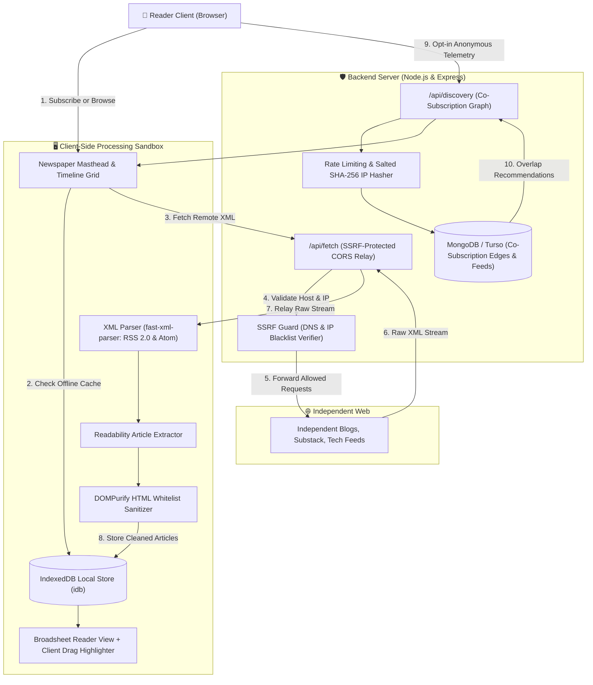

# IncogniRead — Anonymous Discovery Engine & Offline Reader for Independent Blogs
> **Hackathon Submission · PS-003: Small Web Reader**  
> **Team NullVoid · PF-F4SKBW**  
> *No Accounts · No Tracking · No Ranking*

---

## ✦ Overview

**IncogniRead** is an offline-first, client-parsed web reader and anonymous discovery engine designed for the open independent web (RSS 2.0 & Atom).

Modern web readers rely on centralized algorithmic feeds that track users and profile reading habits. IncogniRead restores user sovereignty:
1. **Direct Feed Ingestion**: Follow independent writers and publications directly with zero algorithm ranking.
2. **Anonymous Discovery**: Discover new blogs via reader overlap and co-subscription graph analysis without user accounts, cookies, or personal tracking.
3. **Stateless Security Architecture**: Feed parsing, article readability extraction, HTML sanitization (`DOMPurify`), and local persistence (`IndexedDB`) occur 100% inside the browser sandbox. The server only acts as an SSRF-hardened CORS proxy and an anonymous correlation counter.
4. **Authentic Broadsheet Experience**: Broadsheet layout typography, three editions (*Midnight Noir*, *Morning Broadsheet*, *Vintage Gazette*), and an interactive **client cursor drag-to-highlight** system.

---

## 1. 🏛 Architecture Overview

IncogniRead enforces a strict separation of concerns between client-side intelligence and a stateless proxy/graph backend.



### Component Roles & Responsibilities

| Layer | Component | Implementation | Responsibility |
| :--- | :--- | :--- | :--- |
| **Client** | **Feed Parser** | `fast-xml-parser` | In-browser parsing of RSS 2.0 and Atom XML feeds into structured articles. |
| **Client** | **Content Extractor** | Readability Parser | Strips page chrome, navigation menus, and footers, extracting clean article prose. |
| **Client** | **HTML Sanitizer** | `DOMPurify` | Strict whitelist-only HTML sanitization, blocking `<script>`, `<iframe>`, and event handlers. |
| **Client** | **Offline Storage** | `IndexedDB` (`idb`) | Complete offline caching of feeds, read/unread states, bookmarks, and full-text dispatches. |
| **Client** | **Client Highlighter** | `highlights.ts` | Direct cursor sweep-and-release text highlighting with 4 pastel broadsheet colors & eraser. |
| **Server** | **CORS Relay** | `/api/fetch` | Stateless stream proxy allowing browsers to bypass CORS restrictions. Never parses or stores content. |
| **Server** | **SSRF Defense** | `lib/ssrf.ts` | Resolves target DNS hostnames and rejects private/loopback/cloud metadata IP ranges. |
| **Server** | **Discovery API** | `/api/discovery` | Aggregates anonymous co-subscription pairs; computes recommendations based on reader overlap. |
| **Server** | **Abuse Guard** | `rateLimiter.ts` | In-memory token bucket rate limiting and salted SHA-256 IP hashing with short TTL. |

---

## 2. ⚡ Setup Instructions

### Prerequisites
* **Node.js**: v18.0.0 or higher
* **npm**: v9.0.0 or higher
* **MongoDB**: Local MongoDB instance (`mongodb://localhost:27017`) or free MongoDB Atlas / Turso URI

### Local Installation & Startup

```powershell
# 1. Clone repository
git clone https://github.com/your-org/incogniread.git
cd incogniread

# 2. Install root and frontend dependencies
npm install

# 3. Install backend dependencies
cd backend
npm install
cd ..

# 4. Start Backend Server (runs on http://localhost:3000)
npm --prefix backend run dev

# 5. In a separate terminal, start Frontend Vite Server (runs on http://localhost:3001)
npm run dev
```

### Environment Variables

#### Backend (`backend/.env`)
```ini
# Server Port (Frontend proxies /api/* calls here)
PORT=3000

# MongoDB Connection String (Atlas, local, or Docker)
MONGODB_URI=mongodb://localhost:27017/incogniread_db

# Allowed CORS Origins
ALLOWED_ORIGINS=http://localhost:3001,http://localhost:3002,http://localhost:5173

# Salt for Anonymous SHA-256 IP Hashing
IP_HASH_SALT=incogniread-secure-salt-2026-pecathon

# Node Environment
NODE_ENV=development
```

#### Frontend (`.env`)
```ini
# Optional base API target override (defaults to Vite proxy /api)
VITE_API_URL=http://localhost:3000
```

---

## 3. 🛡️ Privacy & Threat Model

### Privacy Guarantees

| Data Type | Server Behavior | Client Behavior |
| :--- | :--- | :--- |
| **User Identity** | **Never collected or stored**. No usernames, accounts, emails, or persistent cookies. | Anonymous. |
| **Reading History** | **Never transmitted**. The server never knows which articles you click, read, or skip. | Kept 100% locally in `IndexedDB`. |
| **Highlighted Words** | **Never transmitted**. Client drag highlights remain private on device. | Saved locally in browser `localStorage`. |
| **Subscriptions** | **Opt-in only**. Transmitted as an anonymous set of normalized URLs only when discovery sync is triggered. | Fully manageable and exportable as OPML. |
| **IP Addresses** | **Never logged in plain text**. Immediately hashed using SHA-256 with a secret salt and short-term expiry. | Ephemeral network packet header only. |

---

### Threat Model: What We Defend Against vs. What We Accept

```
                                  THREAT MODEL MATRIX
+-----------------------------------------------------------------------------------------------+
| THREAT VECTOR                 | DEFENSE MECHANISM                           | STATUS         |
+-----------------------------------------------------------------------------------------------+
| Server-Side Request Forgery   | Pre-flight DNS resolution against blocked   | 🛡️ MITIGATED    |
| (SSRF) Attacks                | RFC1918, 127.0.0.1, 169.254.169.254 ranges  |                |
+-----------------------------------------------------------------------------------------------+
| Malicious Script Injection    | Strict client-side DOMPurify sanitization   | 🛡️ MITIGATED    |
| (Cross-Site Scripting / XSS)  | stripping scripts, iframes, and handlers    |                |
+-----------------------------------------------------------------------------------------------+
| Sybil Graph Poisoning         | Batch capped at 50 feeds, 1 submit / 5 min  | 🛡️ MITIGATED    |
| (Fake Co-Subscription Feeds)  | per salted IP hash, minimum distinct weight |                |
+-----------------------------------------------------------------------------------------------+
| Proxy Memory Exhaustion       | 6 MB hard payload ceiling with 10-second    | 🛡️ MITIGATED    |
| (OOM Denial of Service)       | abort controller on all upstream requests   |                |
+-----------------------------------------------------------------------------------------------+
| Distributed ISP / Network     | End-to-end TLS for upstream fetching;       | ⚠️ ACCEPTED     |
| Eavesdropping (Transit)       | client relies on upstream blog HTTPS certs  |    BOUNDARY    |
+-----------------------------------------------------------------------------------------------+
| Local Device Physical Tamper  | Physical access to client IndexedDB can     | ⚠️ OUT OF SCOPE |
| (Device Seizure)              | read cached articles (OS-level encryption)  |    (CLIENT OS) |
+-----------------------------------------------------------------------------------------------+
```

1. **SSRF Guard (`backend/src/lib/ssrf.ts`)**:
   - Before fetching any URL, hostname is resolved via asynchronous DNS lookup.
   - Any IP matching loopback (`127.0.0.0/8`, `::1`), private networks (`10.0.0.0/8`, `172.16.0.0/12`, `192.168.0.0/16`), link-local (`169.254.0.0/16`), or cloud metadata endpoints (`169.254.169.254`, `metadata.google.internal`) is rejected with HTTP 403.
2. **XSS & Content Poisoning**:
   - The server relays raw bytes without evaluating or executing them.
   - The browser parses XML and sanitizes HTML via `DOMPurify` using an explicit allowlist. Any embedded JavaScript, tracking pixels, or iframe payloads are stripped before rendering.
3. **Sybil & Co-Subscription Abuse**:
   - Submissions are limited to batches of at most 50 feeds.
   - Rate limited to 1 submission per 5 minutes per salted IP hash.
   - Self-referencing edges and duplicate URLs are normalized before insertion into the correlation matrix.

---

## 4. 🧪 Demo Instructions & Evaluation Scenarios

### Standard Demo Walkthrough (2–3 Minutes)

1. **Add Seed Blogs & Autodiscovery**:
   - Open IncogniRead at [http://localhost:3001/](http://localhost:3001/).
   - Click **+ Add Blog** in the top navigation bar.
   - Paste a site domain without specifying `/rss.xml` (e.g. `overreacted.io` or `simonwillison.net`).
   - Notice the client autodiscovery mechanism scans `<link rel="alternate">` tags, resolves the feed, and renders the feed articles on the timeline.
2. **Test Offline-First Reading**:
   - Turn off Wi-Fi or toggle the browser DevTools to **Offline Mode**.
   - Notice the top navbar status pill dynamically updates to **OFFLINE (IndexedDB Cache)**.
   - Click any dispatch—the full-text article loads instantly from local storage with complete typography and styling.
3. **Client-Side Drag Highlighting**:
   - Inside the reader view, click and drag your cursor over any sentence or paragraph.
   - The words highlight instantly in pastel champagne upon releasing the mouse.
   - Switch pastel colors (Champagne, Sage, Rose, Lavender) or use the Eraser tool in the top pen bar.
   - Close the reader and notice the article card displays an updated highlight badge on the main timeline.
4. **Anonymous Co-Subscription Discovery**:
   - Click **✦ Discover** in the top bar or sidebar.
   - Review recommendations generated from reader overlap (e.g. *“Followed by readers of Overreacted”*).
   - Click **+ Subscribe** on any recommendation to add it to your timeline.
5. **OPML Import / Export**:
   - Click the **OPML** button in the header.
   - Export your subscriptions as an `.opml` file, or import an existing feed collection in one click.

---

### Edge Cases & Resilience Testing

| Scenario | Test URL / Action | Expected System Behavior |
| :--- | :--- | :--- |
| **No Feed Found** | `https://example.com` | Autodiscovery checks `/feed`, `/rss.xml`, and `<link>` tags; alerts user gracefully if no feed exists. |
| **Dead / Slow Feed** | `http://10.255.255.1` or simulated offline host | SSRF blocker or 10-second timeout aborts cleanly without freezing the timeline. |
| **Malformed XML** | Broken XML payload or HTML 404 page | `fast-xml-parser` catches syntax errors and falls back gracefully to summary or notifies user. |
| **Duplicate URLs** | `https://example.com/rss`, `http://example.com/rss/`, `https://www.example.com/rss` | Normalized to standard canonical URL key; counts as 1 distinct subscription. |
| **SSRF Injection Attempt** | `http://169.254.169.254/latest/meta-data/` | Blocked immediately with HTTP 403 `SSRF Protection: Access Denied`. |
| **Oversized Feed Attack** | Payload > 6 MB | Upstream stream truncated and rejected with HTTP 413 `Payload Too Large`. |

---

## 5. 🌟 Bonus Points Addressed

* **Bonus Quest — Deliberate Seed Trap Handling**:
  The system detects duplicate feeds under variant URLs (e.g., HTTP vs. HTTPS, `www.` vs. bare domain, trailing slashes) and normalizes them into a single canonical feed node before caching or counting correlation weights.
* **Transparent Recommendations**: Every suggested blog in the Discovery view includes an explicit explanation of why it was recommended (e.g., *“Followed by readers of Overreacted”* or *“Trending in Systems & Open Source”*).
* **OPML Import & Export**: One-click import and export supporting standard OPML outline schemas.
* **Per-Feed Folders & Categories**: Organize feeds into custom editorial folders (*Engineering & AI*, *Tech Journalism*, *Systems & Open Source*).
* **Three Classy Broadsheet Editions**: Instant theme switching between *Midnight Noir*, *Morning Broadsheet*, and *Vintage Gazette* with zero transparency bleeding.
* **Direct Cursor Drag-to-Highlight**: Physical pen simulation allowing readers to press and sweep across words to highlight them in authentic pastel tones.

---

## 📜 License

MIT License · Built with pride for **PECathon 2026** by **Team NullVoid · PF-F4SKBW**.
